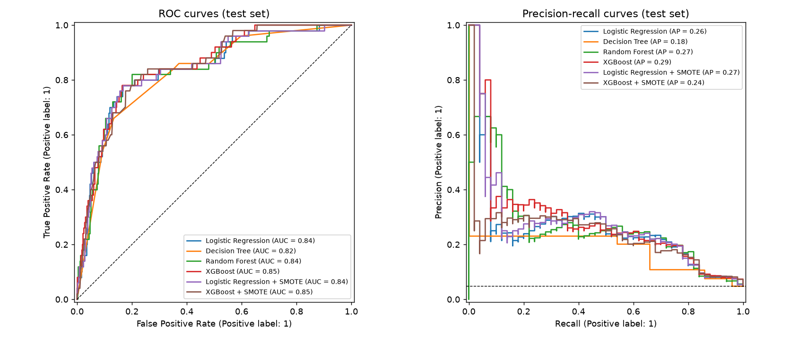
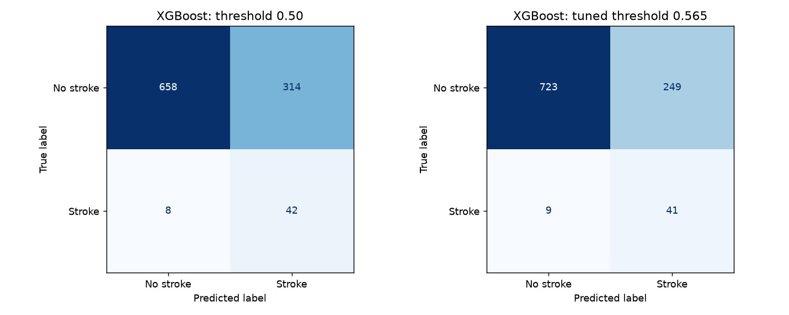
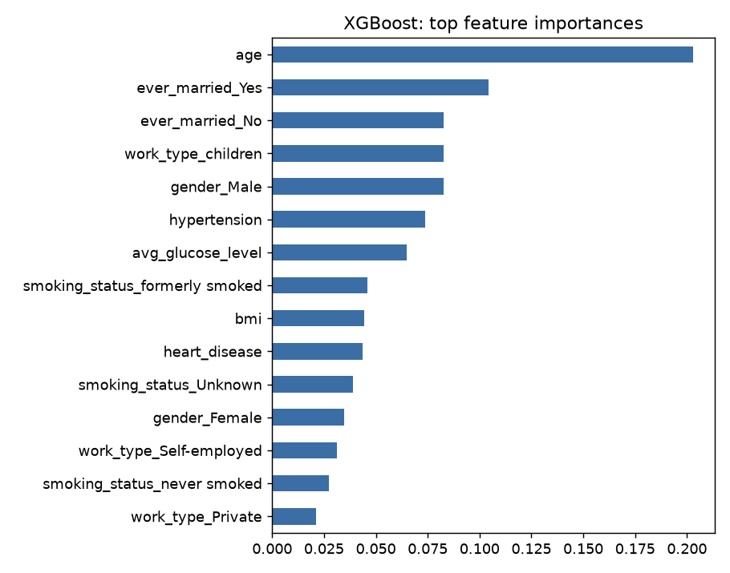

# Stroke Risk Prediction from Patient Clinical Data

An end-to-end classification pipeline that predicts **stroke risk** from patient clinical data, built for a **severely imbalanced** dataset (4.9% positive). Models are chosen on recall, F1 and ROC-AUC, not accuracy, and the decision threshold is tuned so the model catches at-risk patients.

**Stack:** Python, pandas, NumPy, scikit-learn, XGBoost, imbalanced-learn, matplotlib

## Dataset

[Stroke Prediction Dataset](https://www.kaggle.com/datasets/fedesoriano/stroke-prediction-dataset) (`data/healthcare-dataset-stroke-data.csv`)

| | |
|---|---|
| Patient records | 5,110 |
| Stroke cases | 249 (4.9%) |
| Missing BMI | 201 |
| Features | age, BMI, average glucose level, hypertension, heart disease, smoking status, gender, marital status, work type, residence type |

## Pipeline

1. **Preprocessing** (`src/stroke/data.py`), a scikit-learn `ColumnTransformer` fitted on training folds only:
   - numeric columns (`age`, `avg_glucose_level`, `bmi`): median imputation (fills the 201 missing BMI values), then standard scaling
   - categorical columns: one-hot encoding (`handle_unknown="ignore"`)
   - binary flags (`hypertension`, `heart_disease`) are passed through unchanged
2. **Models** (`src/stroke/models.py`): Logistic Regression, Decision Tree, Random Forest, XGBoost.
   - Class imbalance is handled with **class weights** (`class_weight="balanced"` / `scale_pos_weight = neg/pos ≈ 19.5`).
   - For comparison, two **SMOTE** variants (imbalanced-learn) oversample inside each CV fold.
3. **Hyperparameter tuning:** `GridSearchCV` with 5-fold `StratifiedKFold`, refit on ROC-AUC, with recall and F1 also tracked.
4. **Threshold optimization** (`src/stroke/threshold.py`): out-of-fold predicted probabilities on the *training* set are used to pick the highest threshold that still reaches **≥ 80% recall**. That threshold is then applied unchanged to the held-out test set, so the test set never influences the threshold.
5. **Evaluation:** stratified 80/20 hold-out test set (1,022 patients, 50 strokes).

## Results

Held-out test set; rows are sorted by cross-validated ROC-AUC, which is the metric used to pick the model.

| Model | CV ROC-AUC | Test ROC-AUC | Test PR-AUC | Threshold | Recall | Precision | F1 |
|---|---|---|---|---|---|---|---|
| **XGBoost** | **0.847** | **0.850** | **0.288** | 0.565 | **0.82** | 0.14 | 0.24 |
| Random Forest | 0.846 | 0.838 | 0.266 | 0.400 | 0.82 | 0.15 | 0.26 |
| Logistic Regression | 0.840 | 0.842 | 0.264 | 0.509 | 0.80 | 0.14 | 0.24 |
| Logistic Regression + SMOTE | 0.837 | 0.844 | 0.274 | 0.492 | 0.80 | 0.14 | 0.23 |
| XGBoost + SMOTE | 0.822 | 0.848 | 0.238 | 0.587 | 0.84 | 0.14 | 0.23 |
| Decision Tree | 0.820 | 0.825 | 0.180 | 0.486 | 0.84 | 0.11 | 0.19 |

**Best model: XGBoost** (`max_depth=2, n_estimators=400, learning_rate=0.01, subsample=0.8, colsample_bytree=0.8`)

- **ROC-AUC 0.85**, with **82% recall** (41 of 50 stroke patients caught) at the tuned threshold of 0.565.
- Compared with the default 0.5 threshold (recall 84%, 314 false positives), the tuned threshold cuts false positives by 21% (to 249) and raises F1 from 0.21 to 0.24, while still meeting the 80% recall target.
- A naive "always predict no stroke" model would get 95% accuracy and 0% recall, which is why accuracy is not used for model selection.
- With 50 positive cases in the test set, each patient is worth 2 recall points, so differences between the top models are within noise.





## Run it

```bash
python -m venv .venv
.venv/Scripts/activate        # Windows; use `source .venv/bin/activate` on macOS/Linux
pip install -r requirements.txt
pytest                        # unit tests for preprocessing and threshold selection
python train.py               # ~2.5 min; writes results/ (use --target-recall to change the target)
```

## Project layout

```
data/       healthcare-dataset-stroke-data.csv
src/stroke/ data.py (loading + preprocessing), models.py (models + grids), threshold.py
tests/      pytest unit tests
train.py    tuning, threshold selection, evaluation, plots
results/    model_comparison.csv, best_model.json, plots
```

## Limitations

This is a learning project on a public dataset, not a clinical tool. Precision is low (~14%) at high recall, so most flagged patients would not have a stroke. That trade-off can be acceptable for screening, but not for diagnosis.
